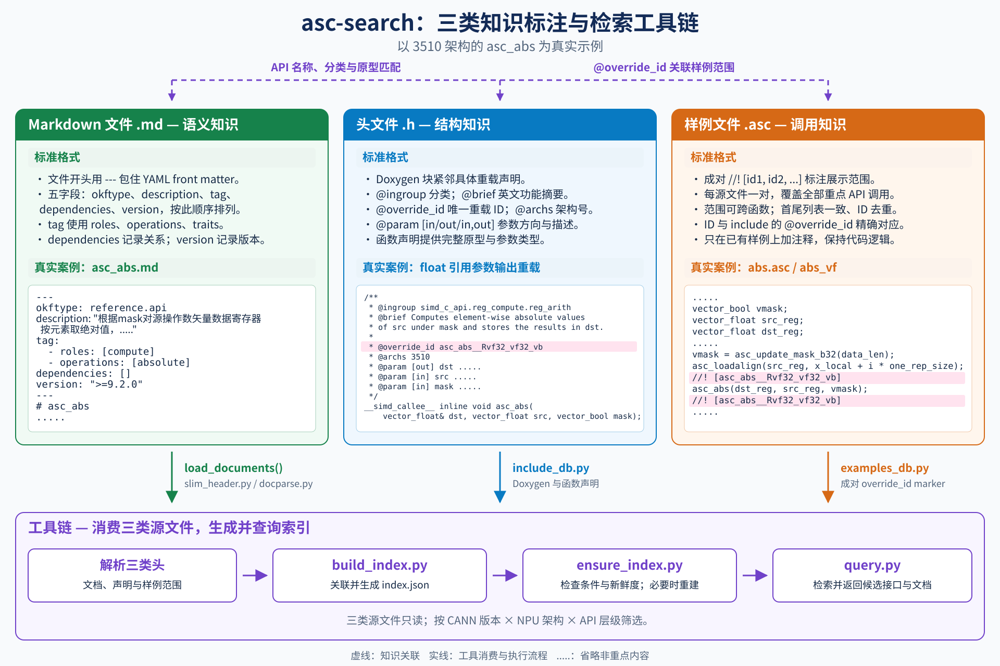

# OKF Search README

## 快速开始

先克隆完整的 asc-devkit 仓库，在仓库根目录执行（Python 3.10+）：

```bash
python3 .agent/skills/asc-search/scripts/install.py
```

这一条命令将 `asc-search` 以软链安装到 Codex、Claude Code、OpenCode 的用户 skill 目录，
重复执行无需重新安装，已有同名且指向其他位置的 skill 会保留并报出冲突。

| 智能体 | 默认安装位置 |
| --- | --- |
| Codex | `~/.agents/skills/asc-search` |
| Claude Code | `~/.claude/skills/asc-search` |
| OpenCode | `~/.config/opencode/skills/asc-search`（设置 `XDG_CONFIG_HOME` 时使用对应配置目录） |

只安装到一个智能体或仅在本项目启用时，可选择：

```bash
python3 .agent/skills/asc-search/scripts/install.py --agent codex
python3 .agent/skills/asc-search/scripts/install.py --scope project
```

`--agent` 可选 `codex`、`claude`、`opencode` 或 `all`（默认）；`--scope project` 使用项目内的
`.agents/skills`、`.claude/skills`、`.opencode/skills`。加 `--dry-run` 可预览安装位置。

检索脚本还依赖 PyYAML；当前 Python 环境未安装时执行：

```bash
python3 -m pip install PyYAML
```

安装后重启或重新加载智能体，在对话中输入：

> 使用 asc-search，帮我找 3510 架构上对 float 向量逐元素取绝对值的接口。

skill 会从安装软链定位原始 devkit 仓库，检查索引后返回候选接口及文档路径。请保留该仓库；
仓库移动后，需要移除旧安装软链并重新运行安装命令。仓库更新后，安装入口会同步使用更新后的 skill。

## 1. 这个 skill 是干什么的

### 1.1 背景

写 Ascend C 算子要用 C API 时，面对的是 800 多篇文档，凭记忆按目录翻很慢。`asc-search` 把这些
文档整理成一个能检索的库：你把需求说给 AI，它返回候选接口文档的路径和用途。

### 1.2 它靠什么工作

靠文档里预先写好的三类头：

| 头 | 在哪 | 给检索提供什么 |
| --- | --- | --- |
| 文档头 | 每篇 Markdown 顶部的 5 字段 YAML | 语义：做什么、什么操作、配套什么、哪个版本可用 |
| include 头 | `include/c_api/**/*.h` 声明上方的 Doxygen | 结构：重载编号、适用架构、参数方向 |
| examples 头 | 每源文件重点 API 共同范围首尾的 `//! [id1, id2, ...]` 成对标记 | 关联：同一展示范围对应哪些重载；单 ID 标记仍兼容 |

`asc-search` 把三类头推导成一份持久索引，查询时只查索引、按需打开候选文档，不需要现场全文搜索。



### 1.3 两个工作流

1. **建立索引**：三类头 → 按适用条件筛选的持久索引（CANN 版本 × 架构 × 层级）。索引是纯派生数据，
   校验不过不出索引，同样输入两次构建结果字节一致。
2. **使用索引（检索）**：理解需求 → 保障索引就绪 → 多轮查询 → 给出分阶段候选文档。

### 1.4 边界

- 只帮找文档，不生成算子代码、不替你写 kernel。
- 当前只覆盖 C API（`docs/zh/api/SIMD-API/c_api/`）；其他层级会如实标注"范围外"。
- 不改文档、不改索引构建产物。

## 2. 怎么用（skill 使用方法）

### 2.1 接入方式

按前面的[快速开始](#快速开始)安装到智能体的 skill 目录。`asc-search` 的源码统一放在
`.agent/skills/asc-search/`，安装入口通过软链访问它。若工具不支持自动加载，在对话里补一句
"按 `.agent/skills/asc-search/SKILL.md` 的流程帮我找……"。

### 2.2 直接提问

把需求用自然语言说给 AI 即可，例如：

- "把 GM 上的数据搬到 UB，用哪个接口？"
- "想把 half 转成 fp8，有哪些接口？"
- "asc_xxx 这个接口要搭配什么接口一起用？"
- "9.1.0 起可用的拷贝接口有哪些？"

一句话里可以同时带上阶段、数据类型、版本、产品、行为约束（如非对齐、填充），说得越具体候选越准。

示例：你说"在 3510 架构上想对 float 向量逐元素取绝对值"，AI 会先按 3510 架构准备索引，
再按"操作=absolute、类型=float"查询，返回
`docs/zh/api/SIMD-API/c_api/reg_compute/reg_arith/asc_abs.md` 及一句话用途；如果需求有歧义，它会先反问你。

### 2.3 skill 给什么结果

回答包含候选接口、文档路径和用途，以及适用条件和待确认事项。
信息不足时会先澄清；未检索到时会如实说明，不把空结果当成“仓库不支持”。正式检索的输出结构为：

```text
## 候选
- 路径: docs/zh/api/SIMD-API/c_api/xxx/yyy.md | API: asc_yyy | 用途: 一句话
```

返回多个候选且无法确认已覆盖当前需求的全部适用接口时，会在候选列表后注明：

> **候选仅供参考，不代表全量接口。**

下面四张问答卡片来自实际检索与候选文档核对，按 **CANN 9.2.0 × 3510 × C API** 整理。
卡片将候选压成表格，点击接口名即可打开对应文档。换版本或架构后，应重新检索，结果可能不同。

<details>
<summary>问答 1：把 GM 上的数据搬到 UB，用哪个接口？</summary>

**回答来源：** cannbot glm5.3（独立检索后经候选文档核对、整理）。

**答：** 先看 `asc_copy_gm2ub`；搬运长度不是 32 字节整数倍，或需要填充、多维搬运时，再看对应候选。

**候选**

| 接口与文档 | 用途与选择条件 |
| --- | --- |
| [asc_copy_gm2ub](../../../docs/zh/api/SIMD-API/c_api/vector_datamove/asc_copy_gm2ub/asc_copy_gm2ub_arch_3510.md) | GM→UB，支持连续搬运和高维切分搬运；目的 UB 地址须 32 字节对齐，长度非 32 字节整数倍时需要为 UB 侧补齐写入预留空间。 |
| [asc_copy_gm2ub_align](../../../docs/zh/api/SIMD-API/c_api/vector_datamove/asc_copy_gm2ub_align/asc_copy_gm2ub_align_arch_3510.md) | GM→UB，支持搬运长度不是 32 字节整数倍的数据，并补齐至 32 字节对齐；长度仍需满足数据类型的字节对齐要求，起始地址要求见参数说明。填充方式和循环搬运配置按所选原型与参数确定。 |
| [asc_ndim_copy_gm2ub](../../../docs/zh/api/SIMD-API/c_api/vector_datamove/asc_ndim_copy_gm2ub.md) | 最多 5 维、各维独立步长的 GM→UB 搬运，支持随路 Padding。 |

以上接口仅在 AIV 上生效。具体选择还需确认数据类型、搬运维度、对齐和填充要求。
如果本指令与其他指令存在数据依赖，需要插入[同步指令](../../../docs/zh/api/SIMD-API/c_api/sync/system_sync_overview.md)，保证多个指令串行化，防止出现异常数据。

</details>

<details>
<summary>问答 2：想把 half 转成 fp8，有哪些接口？</summary>

**回答来源：** cannbot glm5.3（独立检索后经候选文档核对、整理；饱和配置已按功能接口更新）。

**答：** 当前范围没有检出 half→`fp8_e4m3fn_t` / `fp8_e5m2_t` 的单步转换接口。
可以继续核对“half→float→fp8”的分步转换候选：

**候选**

| 接口与文档 | 用途 |
| --- | --- |
| [asc_half2float](../../../docs/zh/api/SIMD-API/c_api/reg_compute/reg_convert/asc_half2float.md) | 将 half 矢量寄存器元素转换为 float，作为中间步骤。 |
| [asc_float2e4m3_rn / asc_float2e4m3_rn_sat](../../../docs/zh/api/SIMD-API/c_api/reg_compute/reg_convert/asc_float2e4m3.md) | 将 float 转为 `fp8_e4m3fn_t`，分别对应非饱和与饱和形式。 |
| [asc_float2e5m2_rn / asc_float2e5m2_rn_sat](../../../docs/zh/api/SIMD-API/c_api/reg_compute/reg_convert/asc_float2e5m2.md) | 将 float 转为 `fp8_e5m2_t`，分别对应非饱和与饱和形式。 |

分步转换前，需要确定目标 fp8 类型、是否采用饱和模式，以及结果的数据布局。
`asc_half2float` 按位置标签读取源寄存器中的偶数或奇数位置，float→fp8 接口则按位置标签将结果写入目的寄存器中每隔 4 个元素的位置。
因此，两步转换不会自动得到连续排列的 fp8 数据，需要根据目标布局处理位置选择和结果重排。

如需配置全局饱和模式，使用
[asc_set_saturation_strategy](../../../docs/zh/api/SIMD-API/c_api/spr/asc_set_saturation_strategy.md) 选择策略，使用
[asc_set_saturation_flag](../../../docs/zh/api/SIMD-API/c_api/spr/asc_set_saturation_flag.md) 设置对应模式的开关。
开启 `FLOAT8` 饱和时，应先将策略设为 `USE_GLOBAL`，再依次开启 `FLOAT` 和 `FLOAT8` 饱和。
转换时还需根据所选接口的文档，确认其饱和或非饱和形式与全局配置的生效条件。

</details>

<details>
<summary>问答 3：asc_xxx 这个接口要搭配什么接口一起用？</summary>

**回答来源：** cannbot glm5.3（独立检索后经候选文档核对、整理）。

**答：** 请把 `asc_xxx` 换成完整接口名，也可以提供接口文档路径。
不同接口的配置、同步与条件依赖不同，明确名称后才能检索配套关系。

**补充提问示例：** “asc_ndim_copy_gm2ub 要搭配什么接口一起用？”

如果本指令与其他指令存在数据依赖，需要插入[同步指令](../../../docs/zh/api/SIMD-API/c_api/sync/system_sync_overview.md)，保证多个指令串行化，防止出现异常数据。

**候选**

| 配套接口与文档 | 何时使用 |
| --- | --- |
| [asc_set_ndim_loop0_stride 至 asc_set_ndim_loop4_stride](../../../docs/zh/api/SIMD-API/c_api/vector_datamove/asc_set_ndim_loop_stride.md) | 搬运前配置各维源、目的步长，单位为元素个数。 |
| [asc_set_ndim_pad_count](../../../docs/zh/api/SIMD-API/c_api/vector_datamove/asc_set_ndim_pad_count.md) | 配置 loop1 至 loop4 的左右填充数；loop0 填充数由搬运接口参数设置。 |
| [asc_set_ndim_pad_value](../../../docs/zh/api/SIMD-API/c_api/vector_datamove/asc_set_ndim_pad_value.md) | `padding_mode=true` 时，搬运前配置与数据类型一致的常数填充值。 |
| [asc_ndim_copy_dci](../../../docs/zh/api/SIMD-API/c_api/vector_datamove/asc_ndim_copy_dci.md) | 多核可能读取同一 GM 地址，且数据可能被其他核更新时，搬运前刷新 NDDMA DataCache。 |
| [asc_lock](../../../docs/zh/api/SIMD-API/c_api/sync/intra_core_sync/asc_lock.md)、[asc_unlock](../../../docs/zh/api/SIMD-API/c_api/sync/intra_core_sync/asc_unlock.md) | 核内不同流水存在数据依赖时，3510 架构优先使用这组接口。每组调用须使用相同的 `pipe`、`mutex_id` 和 `mode`，先 lock 后 unlock，且相同 `mutex_id` 的组合不得嵌套。 |
| [asc_sync_notify](../../../docs/zh/api/SIMD-API/c_api/sync/intra_core_sync/asc_sync_notify.md)、[asc_sync_wait](../../../docs/zh/api/SIMD-API/c_api/sync/intra_core_sync/asc_sync_wait.md) | 通过事件实现核内不同流水之间的同步时，配对发送和等待同一事件。 |

配套关系有各自的触发条件，并非每次搬运都需要调用表中的全部接口。

</details>

<details>
<summary>问答 4：9.1.0 起可用的拷贝接口有哪些？</summary>

**回答来源：** cannbot glm5.3（独立检索后经候选文档核对、整理）。

**答：** 这里需要先确认：你想找“文档标为从 9.1.0 开始支持”的接口，
还是“在 CANN 9.1.0 中可用的全部拷贝接口”？后者也包括更早版本引入的接口，需要按目标架构与 9.1.0 重新准备索引。

**补充提问示例：** “目标 3510、当前 CANN 9.2.0，找文档 version 标为 `>=9.1.0` 的拷贝接口。”

**候选**

| 接口与文档 | 用途 |
| --- | --- |
| [asc_copy_gm2ub](../../../docs/zh/api/SIMD-API/c_api/vector_datamove/asc_copy_gm2ub/asc_copy_gm2ub_arch_3510.md) | GM→UB。 |
| [asc_copy_ub2gm](../../../docs/zh/api/SIMD-API/c_api/vector_datamove/asc_copy_ub2gm/asc_copy_ub2gm_arch_3510.md) | UB→GM。 |
| [asc_copy_ub2l1](../../../docs/zh/api/SIMD-API/c_api/vector_datamove/asc_copy_ub2l1.md) | UB→L1。 |
| [asc_copy_ub2ub](../../../docs/zh/api/SIMD-API/c_api/vector_datamove/asc_copy_ub2ub.md) | UB 内部搬运。 |
| [asc_copy_gm2l1_align](../../../docs/zh/api/SIMD-API/c_api/cube_datamove/cube_compute_load/asc_copy_gm2l1_align.md) | GM→L1，支持搬运长度不是 32 字节整数倍的数据，并补齐至 32 字节对齐；长度仍需满足数据类型的字节对齐要求，起始地址要求见参数说明。 |
| [asc_copy_gm2l1_dn2nz](../../../docs/zh/api/SIMD-API/c_api/cube_datamove/cube_compute_load/asc_copy_gm2l1_dn2nz.md) | GM→L1，并做 DN→Nz 格式转换。 |
| [asc_copy_gm2l1_nd2nz](../../../docs/zh/api/SIMD-API/c_api/cube_datamove/cube_compute_load/asc_copy_gm2l1_nd2nz_arch_3510.md) | GM→L1，并做 ND→Nz 格式转换。 |
| [asc_copy_l0c2gm](../../../docs/zh/api/SIMD-API/c_api/cube_datamove/cube_compute_store/asc_copy_l0c2gm_arch_3510.md) | L0C→GM，可组合随路量化、激活与格式转换。 |
| [asc_copy_l0c2ub](../../../docs/zh/api/SIMD-API/c_api/cube_datamove/cube_compute_store/asc_copy_l0c2ub.md) | L0C→UB，可组合随路量化、激活与格式转换。 |
| [asc_copy_l12bt](../../../docs/zh/api/SIMD-API/c_api/cube_datamove/cube_compute_load/asc_copy_l12bt_arch_3510.md) | L1→BiasTable Buffer。 |
| [asc_copy_l12fb](../../../docs/zh/api/SIMD-API/c_api/cube_datamove/cube_compute_load/asc_copy_l12fb_arch_3510.md) | L1→Fixpipe Buffer，搬运量化或激活参数。 |
| [asc_copy_l12l0b_mx](../../../docs/zh/api/SIMD-API/c_api/cube_datamove/cube_compute_load/asc_copy_l12l0b_mx.md) | L1→L0B_MX Buffer，搬运右矩阵量化系数。 |
| [asc_copy_l12l0b_trans](../../../docs/zh/api/SIMD-API/c_api/cube_datamove/cube_compute_load/asc_copy_l12l0b_trans_arch_3510.md) | L1→L0B，并做二维分形转置。 |
| [asc_copy_l12ub](../../../docs/zh/api/SIMD-API/c_api/cube_datamove/cube_compute_store/asc_copy_l12ub.md) | L1→UB。 |

> **候选仅供参考，不代表全量接口。**

此处按文档 `version` 区间精确匹配并筛去废弃接口；更早引入或标为 `>=9.2.0` 的接口不在这张表中。
表中结果反映当前筛选条件下的文档标注，不代表已验证这些 3510 接口能在历史 CANN 9.1.0 环境运行。

</details>

## 3. 三类头的标准格式与真实示例

三类头分别描述 API 的语义、具体重载的结构和源码调用范围。本章以 3510 架构的 `asc_abs`
为贯穿示例，样例源码使用仓库原有的 `abs.asc`，只增加 marker 注释。真实片段取自
`okf-knowledge-user` 分支；本 README 在 user、test 两分支保持一致，示范文件的标注范围
可以不同。索引如何推导这些字段见[索引推导契约](references/index_derivation_contract.md)。

### 3.1 文档头：Markdown YAML front matter

**标准格式**

文档开头使用 `---` 包住 YAML，固定五个字段并按以下顺序排列。下方模板的占位内容需替换为
实际摘要、冻结词表值、依赖目标和版本；没有依赖时写 `dependencies: []`。

```yaml
---
okftype: reference.api
description: "接口核心动作、处理对象与关键约束的中文摘要。"
tag:
  - roles: [角色标签]
  - operations: [操作标签]
  - traits: [特性标签]
dependencies:
  - path: docs/zh/api/相关文档.md
    kind: constrained_by
version: ">=版本号"
---
# API 名称
```

| 字段 | 标准含义 |
| --- | --- |
| `okftype` | 页面种类；本例为接口文档 `reference.api`。 |
| `description` | 简洁说明核心行为和关键约束。 |
| `tag` | 只写 `roles`、`operations`、`traits`，值来自冻结词表；不适用的 namespace 省略。 |
| `dependencies` | 正文有依据的文档关系，包含 `path`、`kind`；条件关系可带 `condition`。 |
| `version` | CANN 生命周期区间，不表示芯片架构。 |

架构、签名、重载 ID、头文件位置和样例关联由索引推导，不写入这五个字段。

**真实示例**

来源：`docs/zh/api/SIMD-API/c_api/reg_compute/reg_arith/asc_abs.md`。

```yaml
---
okftype: reference.api
description: "根据mask对源操作数矢量数据寄存器按元素取绝对值，结果写入目的操作数或通过函数返回值返回；输入为有符号整数类型最小负值时结果保留原值不变。"
tag:
  - roles: [compute]
  - operations: [absolute]
dependencies: []
version: ">=9.2.0"
---
# asc_abs
```

该头表达逐元素取绝对值的行为和有符号整数最小负值的处理约束；`dependencies: []`
表示当前未标注文档依赖。文档标题和正文原型用于匹配 include 声明。

### 3.2 include 头：Doxygen 与函数声明

**标准格式**

Doxygen 块放在每个具体重载声明上方，功能摘要和参数描述使用英文。每个重载用一句 `@brief`
说明核心动作及结果输出方式，术语参考 `docs/en/`；摘要后用一行空注释结束，再写结构字段。
`override_id` 按具体签名生成，
同名函数的不同重载各有独立 ID；参数类型来自紧随注释的声明。

```cpp
/**
 * @ingroup simd_c_api.<API category>
 * @brief <English summary of the concrete overload's behavior and result output>
 *
 * @override_id <canonical overload ID>
 * @archs <NPU architecture numbers>
 * @param [out] dst Destination operand.
 * @param [in] src Source operand.
 * @param [in,out] state Input and output state.
 */
// The corresponding concrete function declaration follows here.
```

| 标注 | 标准含义 |
| --- | --- |
| `@ingroup` | API 所属分类。 |
| `@brief` | 具体重载的一句英文功能摘要，区分输出参数与返回值形式。 |
| `@override_id` | 具体重载的唯一 ID，也是连接样例的键。 |
| `@archs` | 适用架构号，如 `3510`；多个架构按空格分隔。 |
| `@param [in/out/in,out]` | 参数名、方向及英文语义描述，需与声明对应。 |

**真实示例**

来源：`include/c_api/reg_compute/compute/reg_arith.h`，以下展示通过引用参数输出结果的 `float` 重载。

```cpp
/**
 * @ingroup simd_c_api.reg_compute.reg_arith
 * @brief Computes element-wise absolute values of src under mask and stores the results in dst.
 *
 * @override_id asc_abs__Rvf32_vf32_vb
 * @archs 3510
 * @param [out] dst Destination operand (vector data register).
 * @param [in] src Source operand (vector data register).
 * @param [in] mask Mask register that controls whether each element participates in the computation.
 * A value of 1 selects the corresponding element; a value of 0 excludes it. Unselected elements are set to zero.
 */
__simd_callee__ inline void asc_abs(vector_float& dst, vector_float src, vector_bool mask);
```

`dst` 是输出，`src`、`mask` 是输入；`@archs 3510` 表示适用 3510 架构。同名函数的其他
数据类型和返回方式有独立 ID，例如返回 `float` 矢量的重载使用 `asc_abs__vf32_vb`。
该返回值形式的摘要为 `@brief Returns element-wise absolute values of src under mask.`。
`@brief` 供开发者阅读，当前索引仍从文档头获取语义摘要，不额外索引 include 的 brief。

### 3.3 样例头：成对 override_id marker

**标准格式**

每个源文件用一对 marker 包住所有重点 API 的共同展示范围，从首次重点调用所在行到末次
重点调用结束行，可跨函数。首尾 ID 列表一致，ID 去重，并与 include 中的 `@override_id`
精确对应。范围是展示片段，不要求独立编译。只在仓库已有样例上增加 marker 注释，不新建样例或改写代码逻辑。

```cpp
//! [id1, id2, ...]
// Shared source range containing the featured API calls.
//! [id1, id2, ...]
```

只有一个重载时仍使用 `//! [override_id]`；同一重载调用多次，在列表中只出现一次。

**真实示例**

来源：`examples/02_simd_c_api/03_c_api/02_reg_vector_compute/abs/abs.asc`，以下为 `abs_vf` 函数内片段。
该文件原本就存在，标注只增加首尾两行注释。

```cpp
vector_bool vmask;
vector_float src_reg;
vector_float dst_reg;
for (uint16_t i = 0; i < repeat_time; ++i) {
    vmask = asc_update_mask_b32(data_len);
    asc_loadalign(src_reg, x_local + i * one_rep_size);
    //! [asc_abs__Rvf32_vf32_vb]
    asc_abs(dst_reg, src_reg, vmask);
    //! [asc_abs__Rvf32_vf32_vb]
    asc_storealign(y_local + i * one_rep_size, dst_reg, vmask);
}
```

三类头通过“文档的 API 名称与原型 → include 具体声明 → `override_id` → 样例范围”关联。
`build_index.py` 消费它们生成索引，`ensure_index.py` 检查索引新鲜度，`query.py` 再从索引检索
接口、文档和样例关联。
